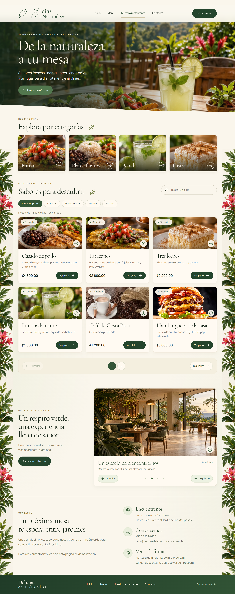
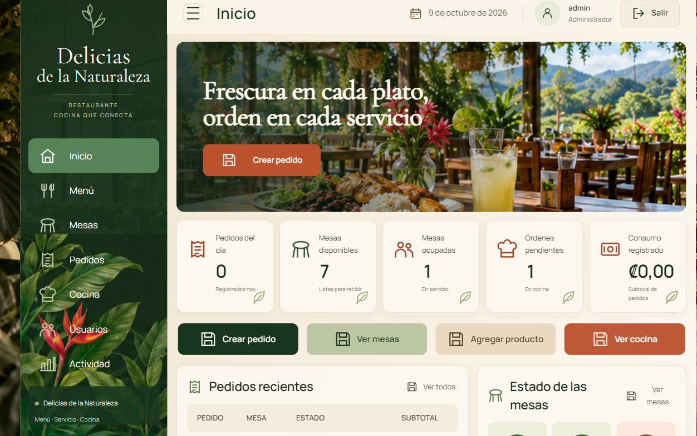
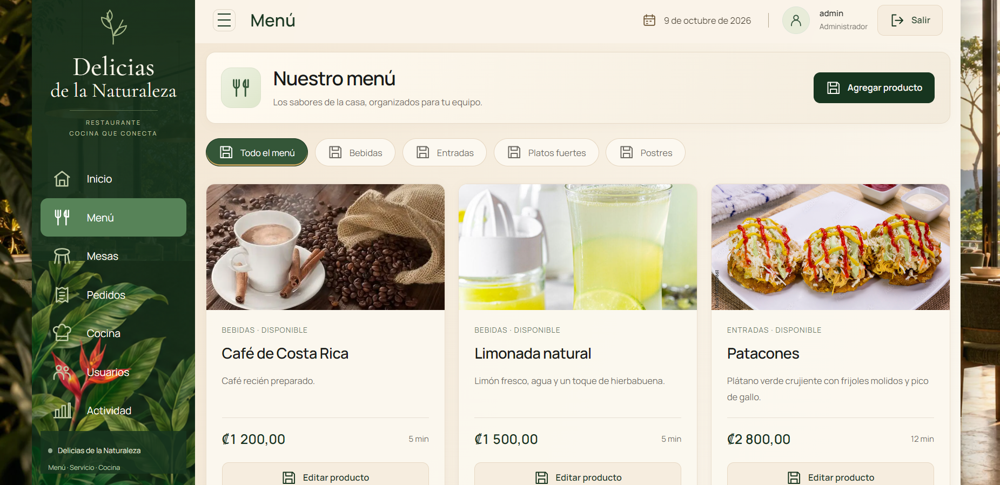
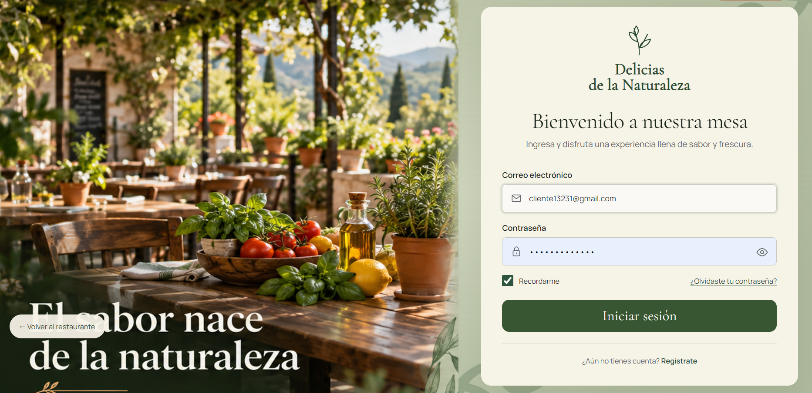

# Delicias de la Naturaleza 🌿

Aplicación web para un restaurante inspirado en la cocina costarricense y los espacios rodeados de jardines. Combina una página pública para explorar los platos y conocer el restaurante con un panel para organizar el menú, las mesas y los pedidos.

Proyecto de portafolio desarrollado con **JavaScript, Node.js, Express, SQL Server y Bootstrap**. Su diseño utiliza verdes, tonos crema, detalles botánicos y fotografías de comida.

## Vista de la página

La página principal presenta el restaurante, las categorías del menú, los platos y una galería de ambientes. El menú incluye búsqueda, filtros y paginación de seis platos; al pulsar una foto se abre una vista ampliada con su descripción y precio.



## Panel de administración

Un resumen del servicio muestra los pedidos del día, las mesas disponibles y ocupadas, las órdenes pendientes y el consumo registrado. Desde el panel se accede al menú, mesas, pedidos, cocina, usuarios y actividad según el rol.



### Gestión del menú

Permite agregar y editar productos, cambiar precios, descripción, categoría, disponibilidad y tiempo de preparación. También permite subir, reemplazar y quitar fotografías JPG, PNG o WebP de hasta 5 MB. El buscador y la paginación facilitan recorrer un menú con muchos platos.



### Acceso al sistema

El acceso conserva el estilo natural del restaurante. Las sesiones y los permisos controlan qué funciones puede utilizar cada integrante del equipo.



> Las capturas muestran el proyecto durante su desarrollo; algunos detalles pueden variar con las mejoras más recientes. Los datos de contacto de la página son ficticios y se utilizan para la demostración.

## Funciones principales

- Página pública adaptable a celulares, con menú, precios y disponibilidad.
- Búsqueda por nombre, descripción y categoría; seis platos por página.
- Fotografías de platos ampliables y galería del restaurante con navegación.
- Administración de productos y carga de imágenes con vista previa.
- Gestión de mesas, cantidades y observaciones de pedidos.
- Flujo de pedidos: abierto → pendiente → preparando → listo → entregado.
- Vista de cocina con actualización automática cada 15 segundos.
- Usuarios, roles, sesiones en SQL Server y contraseñas protegidas con scrypt.
- Registro de actividad y validación de operaciones en el servidor.

**Alcance:** el consumo registrado es el subtotal de los pedidos. El proyecto todavía no implementa cobros, facturación ni impuestos. Consulta [el alcance del proyecto](docs/alcance.md).

## Tecnologías

| Parte | Tecnología |
| --- | --- |
| Interfaz | HTML, CSS, JavaScript y Bootstrap 5 |
| Servidor | Node.js y Express |
| Base de datos | Microsoft SQL Server |
| Acceso | Sesiones, roles y protección CSRF |
| Pruebas | Node.js Test Runner |

## Ejecutar localmente

Necesitas **Node.js 22.9 o posterior**, npm y una instancia de **SQL Server** con autenticación SQL habilitada.

1. Crea una base de datos llamada `Restaurante` en SQL Server.
2. Instala las dependencias:

```sh
npm install
```

3. Copia `.env.example` como `.env` y configura tu servidor, instancia o puerto, base de datos y credenciales SQL. Define un `SESSION_SECRET` aleatorio de al menos 32 caracteres y una contraseña inicial del administrador de al menos 12 caracteres.
4. Prepara la base de datos y ejecuta el proyecto:

```sh
npm run db:setup
npm run dev
```

5. Abre [http://localhost:3000](http://localhost:3000). La página pública se puede visitar sin iniciar sesión; para administrar utiliza los datos configurados en `ADMIN_EMAIL` y `ADMIN_PASSWORD`.

El script de preparación crea las tablas y los datos de ejemplo sin borrar los existentes. Para una instancia con nombre, configura `DB_SERVER` y `DB_INSTANCE`; para un puerto fijo utiliza `DB_PORT` sin `DB_INSTANCE`. SQL Server debe admitir conexiones TCP/IP.

### Fotografías y base de datos

Las fotos cargadas desde el administrador se guardan en `public/uploads/products/`; SQL Server conserva su ruta en `Products.ImageUrl`. Esa carpeta y la base de datos local no forman parte del repositorio: respáldalas por separado para conservar los productos y las fotos que hayas añadido.

El servidor añade automáticamente la columna de imágenes si falta y la cuenta SQL tiene permisos. Como alternativa, ejecuta [product-images.sql](database/product-images.sql). Consulta [la guía de fotos y página pública](docs/pagina-cliente-imagenes.md).

## Pruebas

```sh
npm test
```

Las pruebas cubren reglas de pedidos, contraseñas, tratamiento de imágenes y paginación. Para comprobar el flujo completo con mesas y cocina también necesitas la conexión a SQL Server y una prueba en navegador.

## Estructura del proyecto

```text
database/        Tablas, datos iniciales y ajuste de imágenes
public/          Interfaz, estilos y recursos visuales
src/             API, sesiones, permisos y conexión SQL
scripts/         Preparación de la base y administrador
test/            Pruebas automáticas
docs/            Documentación y capturas de pantalla
```

## Estado del proyecto

Este repositorio contiene el código fuente y las capturas de la aplicación. Subirlo a GitHub no publica automáticamente el servidor ni la base de datos: la aplicación se ejecuta localmente con la configuración indicada arriba.
